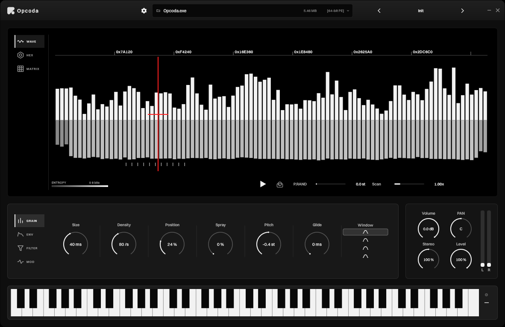
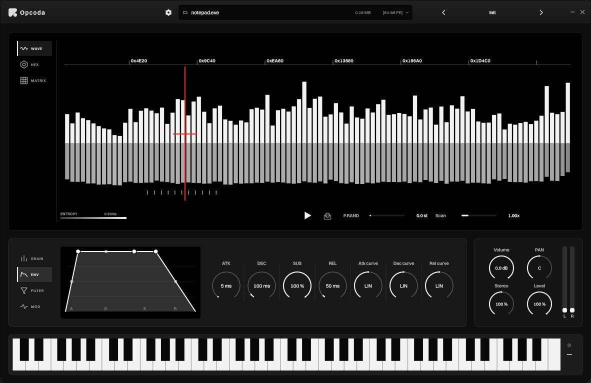
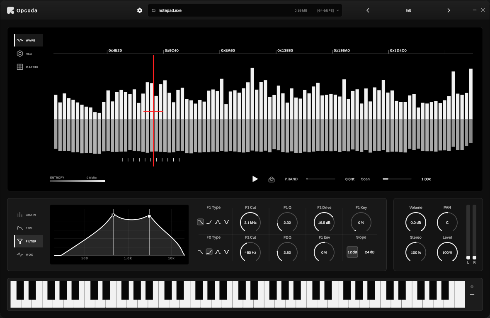
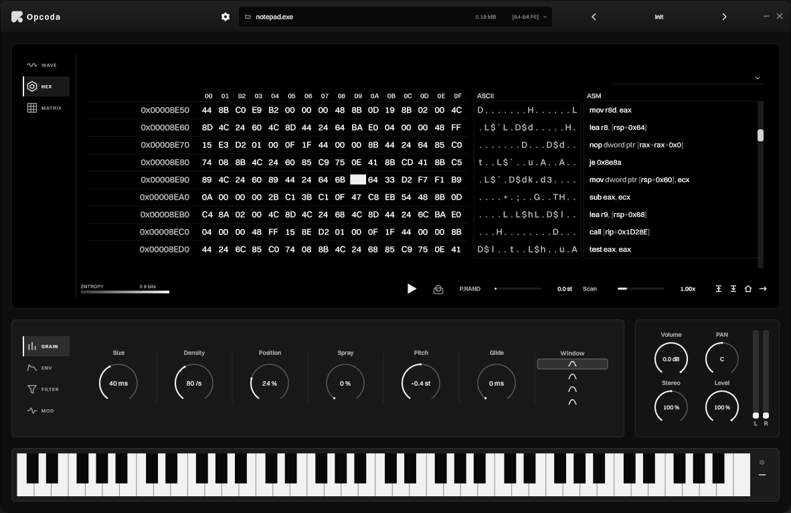
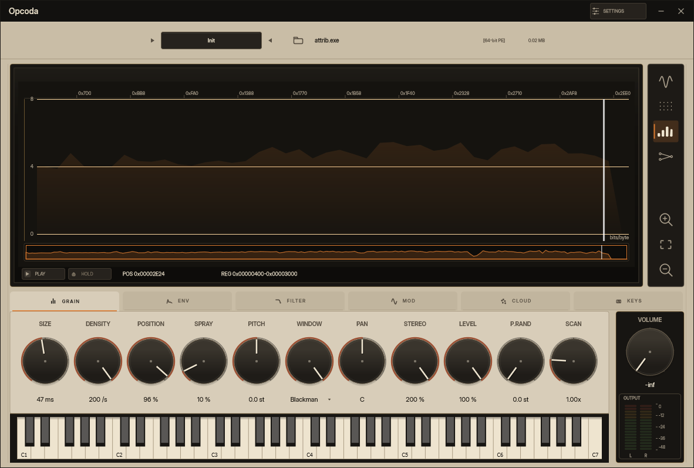

# Opcoda

**A granular synthesizer that reads executables as sound material.**

Opcoda is a VST3 instrument and standalone app for Windows x64. It opens a
Portable Executable (`.exe`, `.dll`, `.bin`, `.sys`), reads its structure, turns the
bytes into samples and plays them through an eight-voice granular engine.

## The idea

Every file has a shape. A Windows executable is not just code: it is a header, sections,
resources and data, each with its own statistical signature. Opcoda treats that
signature as sound material. The grain size, density, position and spray shape the
texture; the filters, envelope and LFO shape the tone; the modulation matrix routes
movement between them.

The sound is not a sample. It is the material itself.

## What is inside

- Eight-voice granular engine with Hann, Gaussian, Hamming and Blackman windows.
- 61 automatable parameters, from grain size to the LFO and the modulation matrix.
- Two serial biquad filters, an ADSR envelope with curves and eight modulation routes.
- Four views of the material: waveform, byte grid with ASM disassembly, entropy curve
  and modulation matrix.
- Transport without MIDI, virtual keyboard and MIDI control.
- Factory presets and `.opcoda` files to save and load state.
- Five themes: Graphite, Classic, Light, Amber and Cyan.

## Design

The interface is a single chassis on an 8 px grid: 16 px margins, 6 px panel radius
and 1 px hairlines. The screen is black glass, the panels are charcoal, the active
state is ivory. The type is Switzer (Medium for labels, Semibold for values), with
tabular figures so addresses and readouts align.

| Graphite | Classic | Light |
| --- | --- | --- |
| black and white | cream and burnt orange | paper and cobalt |
| `#0A0A0A` | `#D6C9AE` | `#F7F4EE` |

| Amber | Cyan |
| --- | --- |
| graphite and amber | graphite and cyan |
| `#FFA726` | `#35D0E0` |

## Screens

| `ENV` | `FILTER` |
| --- | --- |
|  |  |

| `HEX` | `ENTROPY` |
| --- | --- |
|  |  |

## Get it

- Windows 10 or 11, 64-bit.
- VST3 for Ableton Live, Reaper, FL Studio and other hosts.
- Standalone app for playing and designing without a DAW.
- Installer: `Opcoda-Setup-0.1.0.exe`.

More at [bloodwormtrax.neocities.org](https://bloodwormtrax.neocities.org).

#Opcoda #GranularSynthesis #VST3 #AudioPlugin #SoundDesign #MusicTechnology