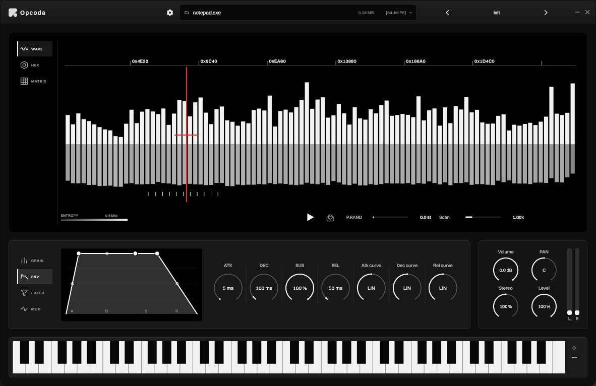
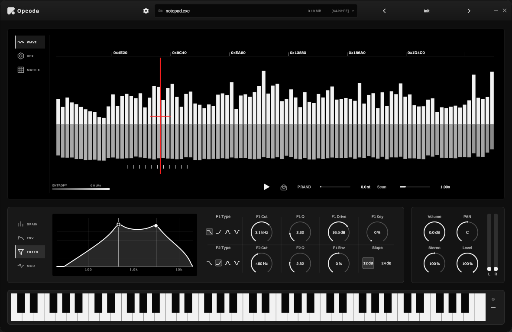
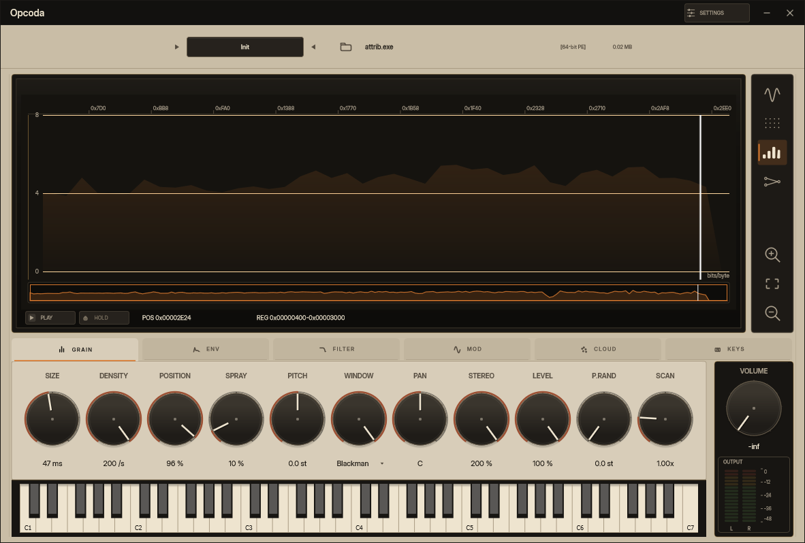



  

<h1 align="center">Opcoda</h1>

  <strong>Granular synthesizer that reads executables as sound material.</strong> 
  VST3 and standalone for Windows x64 &middot; version 0.1.0

## The instrument

Opcoda reads the structure of a PE file (`.exe`, `.dll`, `.bin`, `.sys`), turns its
bytes into samples and plays them through an eight-voice granular engine. The grain
runs from 1 ms to 2 s. Each region of the file has its own statistical signature,
and the instrument exposes that reading in four views: waveform, byte grid with
disassembly, entropy curve and modulation matrix.

The sound does not come from a sample. It comes from the material: the header, the
code, the data. Opcoda is an instrument for texture, noise and rhythm, not a file
player.

## Included

- Eight-voice granular engine with Hann, Gaussian, Hamming and Blackman windows.
- 61 automatable parameters, from grain size to the LFO and the modulation matrix.
- Two serial biquad filters, an ADSR envelope with curves and eight modulation
  routes.
- Four views of the material, including an ASM column that disassembles 64-bit
  code.
- Transport without MIDI, virtual keyboard and MIDI control.
- Factory presets and `.opcoda` files to save and load state.
- Five themes: Graphite, Classic, Light, Amber and Cyan.

## Interface

| `ENV`: ADSR drawn, with the live point | `FILTER`: response of both biquads |
| --- | --- |
|  |  |

| `HEX`: bytes, ASCII and ASM | `ENTROPY` with zoom |
| --- | --- |
|  |  |

The screen is a black glass panel with a navigation rail on the left. The parameter
panel sits below, with the master column on the right and the keyboard at the
bottom. Everything is on an 8 px grid: 16 px margins, 6 px panel radius and 1 px
hairlines. The details are in `design/DESIGN-SYSTEM.md`.

## Themes

The theme changes the whole instrument, from the chassis to the last label, and is
saved.

| Graphite | Classic | Light |
| --- | --- | --- |
| black and white, no colour | cream, charcoal and burnt orange | paper, graphite and cobalt blue |
| `#0A0A0A` | `#D6C9AE` | `#F7F4EE` |

| Amber | Cyan |
| --- | --- |
| graphite with amber | graphite with cyan |
| `#FFA726` | `#35D0E0` |

The screen stays black in all of them: that is where the waveform is drawn in
white. Colour lives in the accent, not in the background.

## Requirements

- Windows 10 or 11, 64-bit.
- 4 GB of RAM.
- VST3 host optional (Ableton Live, Reaper, FL Studio).
- The standalone works on its own, without a host.

## Installation

1. Download `Opcoda-Setup-0.1.0.exe` from `installer/Output`.
2. Run it and choose the components: VST3, standalone and manual.
3. The VST3 is installed in `C:\Program Files\Common Files\VST3`.

The installer offers the Microsoft Visual C++ runtime when it is missing. The
install is per machine and asks for elevation.

## License

Use is personal, non-transferable and non-exclusive. You may use the instrument in
your own productions and publish the resulting audio without royalties. You may not
redistribute, sublicense or reverse engineer the software. The full text is in
`installer/LICENSE.txt`.

## Credits

Granular synthesis references: Granulator II (Robert Henke) and Quanta 2.
Design system and interface: `design/DESIGN-SYSTEM.md`.