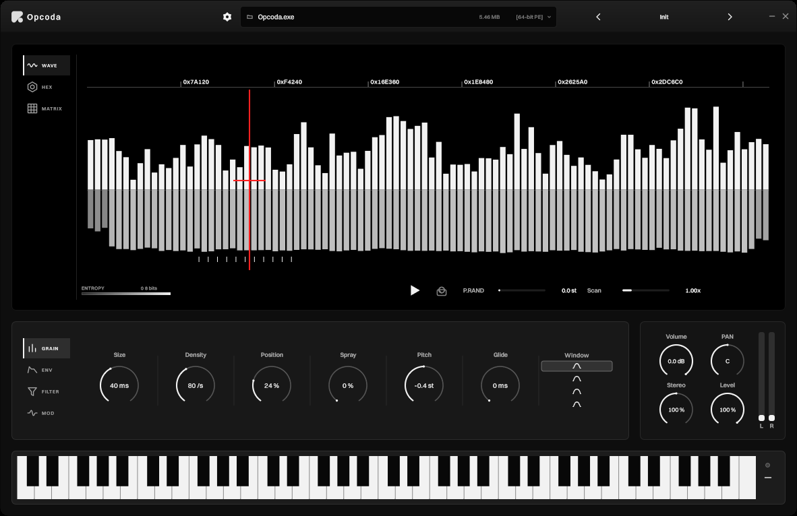
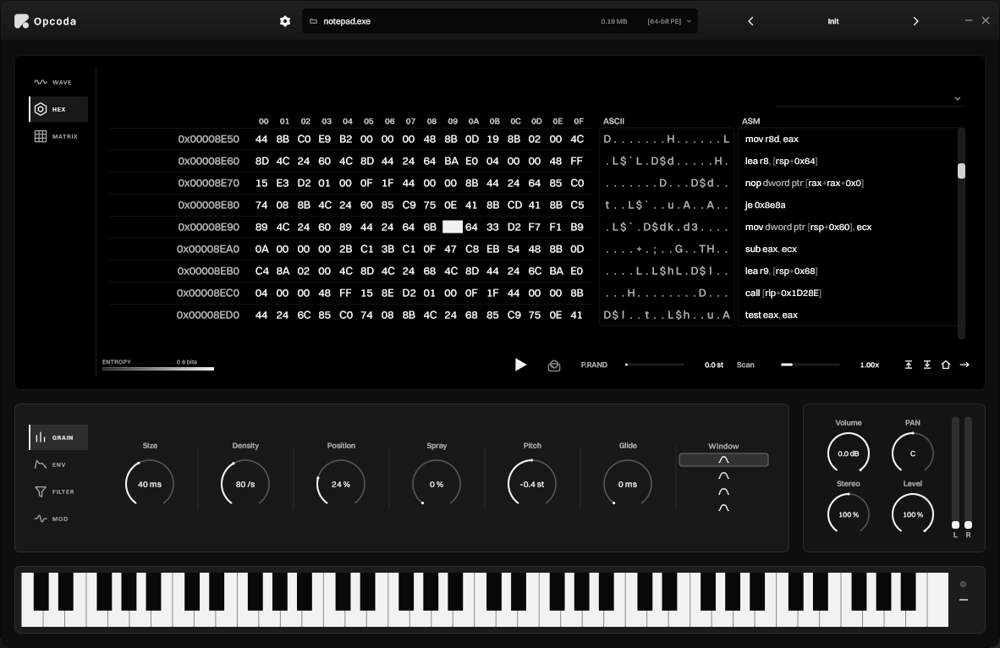

# Opcoda

**A granular synthesizer that reads executables as sound material.**

[](https://github.com/9matesu/Opcoda/releases)
[](https://github.com/9matesu/Opcoda/releases)
[](LICENSE.txt)

> **If you are a musician looking to use Opcoda, download the installer from the
> [releases page](https://github.com/9matesu/Opcoda/releases).** The VST3 and the
> standalone app ship together, and no build step is required.

Opcoda is a VST3 instrument and a standalone application for Windows x64. It opens a
Portable Executable (`.exe`, `.dll`, `.bin`, `.sys`), reads its structure, turns the
bytes into samples and plays them through an eight-voice granular engine. The
instrument is monochrome by design, runs a 61-parameter granular engine and keeps the
whole signal chain allocation-free on the audio path.



## Features

- **Eight-voice granular engine** with Hann, Gaussian, Hamming and Blackman windows.
- **61 automatable parameters**: grain size, density, position, spray, pitch, stereo
  width, two serial biquad filters, ADSR envelope, LFO and an eight-route modulation
  matrix.
- **Four views of the material**: waveform, byte grid with ASM disassembly, entropy
  curve and modulation matrix. The ASM column disassembles 64-bit code with a
  built-in decoder, no external library.
- **Real-time safe by construction**: no allocation, no lock, no I/O on the audio
  path; UI-to-DSP communication goes through atomics and a single-producer queue.
- **Five themes**: Graphite, Classic, Light, Amber and Cyan. The screen stays black
  in all of them, so the waveform always reads.
- **Factory presets** and `.opcoda` files to save and load state.
- **Standalone and VST3** from the same binary.

## Download

| Build | Where |
| --- | --- |
| Installer (VST3 + standalone + manual) | [Releases](https://github.com/9matesu/Opcoda/releases) |
| VST3 bundle | inside the installer |
| Standalone app | inside the installer |

The VST3 is installed to `C:\Program Files\Common Files\VST3`. The standalone is
installed to `C:\Program Files\Opcoda`. The installer offers the Microsoft Visual
C++ runtime when it is missing.

## Screenshots

| `ENV` | `FILTER` |
| --- | --- |
|  |  |

| `HEX` | `ENTROPY` |
| --- | --- |
|  |  |

## The instrument

Every file has a shape. A Windows executable is not just code: it is a header,
sections, resources and data, each with its own statistical signature. Opcoda treats
that signature as sound material. The grain size, density, position and spray shape
the texture; the filters, envelope and LFO shape the tone; the modulation matrix
routes movement between them.

The sound is not a sample. It is the material itself.

## Design system

The interface is one chassis on an 8 px grid: 16 px margins, 6 px panel radius and
1 px hairlines. The screen is black glass, the panels are charcoal, the active state
is ivory. Type is Switzer (Medium for labels, Semibold for values) with tabular
figures, so addresses and readouts align. See [design/DESIGN-SYSTEM.md](design/DESIGN-SYSTEM.md).

| Graphite | Classic | Light |
| --- | --- | --- |
| black and white | cream and burnt orange | paper and cobalt |
| `#0A0A0A` | `#D6C9AE` | `#F7F4EE` |

| Amber | Cyan |
| --- | --- |
| graphite and amber | graphite and cyan |
| `#FFA726` | `#35D0E0` |

## Build

### Windows

Requirements: Visual Studio 2022 or 2026 Build Tools with the MSVC x64 toolchain,
CMake 3.28 or newer, and JUCE 8.0.14 at `I:\deps\JUCE` (override with
`-DJUCE_DIR=`). The first CMake configure fetches GoogleTest 1.15.2.

```
powershell -File tools\build.ps1 -Release
```

The script loads `vcvars64.bat` (the MSVC environment that `cl.exe` needs),
configures the release preset, builds the VST3 and the standalone, and runs the CRT
guard. Do not call `cmake --preset` directly: without the vcvars environment the
compiler will not find the Windows SDK.

To build the installer as well:

```
powershell -File tools\build-installer.ps1
```

The output is `installer/Output/Opcoda-Setup-<version>.exe`. Inno Setup 6 must be
installed.

## Contributing

Issues and pull requests are welcome. The core (`src/opcoda_core`) is pure C++20 with
no JUCE includes; the plugin (`src/opcoda_plugin`) connects it to JUCE. Please read
[AGENTS.md](AGENTS.md) for the build rules and the non-negotiable architecture
constraints before sending a patch.

## License

Opcoda is distributed under the Opcoda End User License Agreement. The full text is
in [LICENSE.txt](LICENSE.txt). The source is available for review; redistribution of
the binaries is governed by that agreement.

## Credits

- Granular synthesis references: Granulator II (Robert Henke) and Quanta 2.
- Design system and interface: [design/DESIGN-SYSTEM.md](design/DESIGN-SYSTEM.md).
- Made by bloodworm trax. More at [bloodwormtrax.neocities.org](https://bloodwormtrax.neocities.org).