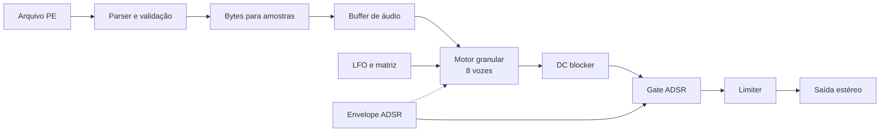

<!-- abre aqui: o que e, como rodar -->

# Opcoda

Sintetizador granular em tempo real para Windows x64. Lê arquivos Portable
Executable (`.exe`, `.dll`, `.bin`, `.sys`) como matéria-prima sonora e organiza
os bytes em grãos de 1 a 100 ms. Existe como VST3 e *standalone*, na versão
0.1.0, ainda sem lançamento comercial.


A captura mostra o *standalone* no estado inicial, sem material carregado. Foi
gerada com `tools/capture-ui.ps1`.

<!-- o recorte -->

## O que é

O Opcoda lê a estrutura de um executável, converte os bytes em amostras
normalizadas e reproduz o resultado com um motor granular de oito vozes. O
usuário controla tamanho do grão, densidade, posição de leitura, dispersão,
afinação, filtros, envelope, LFO e uma matriz de modulação.

O recorte está na fonte. O material não vem de um sample comum; cada região do
arquivo carrega uma assinatura estatística própria, e o instrumento expõe essa
leitura em três vistas: forma de onda, grade de bytes e curva de entropia.

<!-- so o que ja roda -->

## Recursos

- Ingestão de PE com validação de limites e erros tipados (`E_BAD_MZ`,
  `E_BAD_PE`, `E_TRUNCATED`, `E_OOB`, `E_TOO_MANY_SECTIONS`).
- Motor granular de oito vozes, janelas Hann, Gauss, Hamming e Blackman.
- 41 parâmetros automatizáveis: grão, envelope ADSR com curvas, dois filtros
  biquad em série, LFO, teclado e nuvem de grãos.
- Matriz de modulação com oito rotas e oito fontes.
- Presets de fábrica e arquivos `.opcoda` para carregar e salvar.
- Transporte sem MIDI, teclado virtual e controle por MIDI.
- Três vistas do material: forma de onda, grade hexadecimal e entropia.
- Núcleo C++20 sem dependência de JUCE, testado com AddressSanitizer.

<!-- ambiente de build -->

## Requisitos

- Windows x64.
- Visual Studio 2022 ou 2026 Build Tools com MSVC x64.
- CMake 3.28 ou superior.
- JUCE 8.0.14 em `I:\deps\JUCE` (ou outro caminho via `-DJUCE_DIR=`).
- GoogleTest 1.15.2 via `FetchContent` na primeira configuração.

<!-- build, sem atalho -->

## Compilação

```powershell
.\tools\build.ps1          # debug, AddressSanitizer e testes
.\tools\build.ps1 -Release # release, VST3 e standalone
```

O script carrega `vcvars64.bat`. Não chame `cmake --preset` diretamente.

Para compilar um formato depois da configuração Release:

```powershell
cmake --build --preset vst3
cmake --build --preset standalone
```

Testes:

```powershell
ctest --preset dev -C Debug
```

<!-- instalar o vst3 -->

## Instalação do VST3

```powershell
.\tools\install-vst3.ps1
```

O script exige elevação e instala em `C:\Program Files\Common Files\VST3`.
O Ableton Live ignora o caminho VST3 por usuário.

<!-- primeiro som -->

## Primeiro som

1. Abra o *standalone* ou carregue o VST3 em um *host*.
2. Arraste um `.exe`, `.dll`, `.bin` ou `.sys` para a janela, ou use o ícone de
   pasta.
3. Espere o material aparecer. O tempo de carga depende do tamanho do arquivo.
4. Pressione `Espaço` para percorrer a região sem MIDI, ou toque uma nota no
   teclado virtual.
5. Ajuste `SIZE`, `DENSITY` e `POSITION` para moldar o grão. `SPRAY` espalha a
   posição de leitura de cada grão.

Se o arquivo for recusado, a interface mostra o código do erro e mantém o
material anterior tocando.

<!-- knobs da tela -->

## Controles

| Controle | Função |
| --- | --- |
| `SIZE` | Duração do grão, 1 a 100 ms. |
| `DENSITY` | Grãos por segundo, 1 a 200. |
| `POSITION` | Ponto de leitura no material, 0 a 100%. |
| `SPRAY` | Dispersão aleatória da posição de cada grão, 0 a 100%. |
| `PITCH` | Transposição em semitons, -24 a +24. |
| `WINDOW` | Envelope do grão. |
| `PAN` | Posição estéreo. |
| `LEVEL` | Nível de cada grão. |
| `P.RAND` | Desvio aleatório de afinação por grão, 0 a 12 st. |
| `SCAN` | Velocidade da varredura automática, 0,25x a 4x. |

`SPRAY` é dispersão pura: não lê entropia. A entropia só mexe em um parâmetro
quando você roteia `Entropy` na matriz de modulação.

A referência completa dos 41 parâmetros está em `docs/PARAMETERS.md`.

Atalhos: `1`, `2` e `3` alternam as vistas; `Espaço` liga o transporte; `L`
abre um arquivo; `K` leva o foco ao teclado; `A` alinha a região à seção PE mais
próxima.

<!-- fluxo de audio -->

## Arquitetura de áudio



O núcleo fica em `src/opcoda_core` e não inclui JUCE. O plugin em
`src/opcoda_plugin` conecta o núcleo ao JUCE, ao estado do *host* e à interface.
O callback de áudio não aloca, não bloqueia e não faz I/O. A comunicação entre
interface e áudio passa por átomos e uma fila SPSC.

Detalhes em `docs/SOUND_ENGINE.md`.

<!-- presets -->

## Presets

A interface oferece seis presets de fábrica: Init, Cloud, Shimmer, Pulse, Drone
e Grit. O menu de preset carrega e salva arquivos `.opcoda`. O estado do projeto
também guarda o material, a região e a matriz de modulação.

<!-- limites -->

## Requisitos técnicos

- Formato: VST3 e *standalone*.
- Plataforma: Windows x64.
- *Host* verificado: Ableton Live 12.
- Taxa de amostragem: definida pelo *host*.
- Fonte mono, saída estéreo com pan por grão; oito vozes de grão, não oito
  vozes de nota.

<!-- o que falta -->

## Estado do projeto

Implementado e testado: parser PE, motor granular, filtros, LFO, envelope,
matriz, presets, transporte, teclado e as três vistas.

Pendente ou não verificado:

- Medição de p99 e xruns em sessão real (T2).
- Verificação de arrasto, parâmetros e CCs em *host* (T4).
- Correção dos valores iniciais do *standalone* quando há estado de sessão antigo.
- Formato CLAP.
- Visualização da nuvem de grãos.

<!-- defeito conhecido -->

## Limitação conhecida

O *standalone* pode abrir com valores diferentes dos padrões, por exemplo
`100 ms`, `13 /s` e `69%` em vez de `40 ms`, `20 /s` e `50%`. A causa é o estado
de sessão do JUCE em `%APPDATA%\Opcoda\Opcoda.settings`. Apague esse arquivo
para voltar aos padrões. O defeito está documentado em
`docs/16-arquitetura-implementacao.md`.

<!-- licenca -->

## Licença

O repositório não contém arquivo `LICENSE`. A situação jurídica do código ainda
não foi definida. O projeto usa JUCE 8.0.14, com licença dupla GPL/comercial, e
GoogleTest 1.15.2, com licença BSD-3-Clause. Não redistribua o binário sem
resolver essas licenças.

<!-- docs -->

## Documentação

- `docs/USER_GUIDE.md`: instalação, primeiros passos e operação.
- `docs/SOUND_ENGINE.md`: fluxo de sinal, granulação, spray e entropia.
- `docs/PARAMETERS.md`: referência dos parâmetros.
- `docs/DEVELOPMENT.md`: ambiente, build, testes e depuração.
- `docs/ROADMAP.md`: próximos passos.
- `CHANGELOG.md`: histórico de alterações.
- `docs/atlas/`: inventário e diagramas da arquitetura.

<!-- creditos -->

## Créditos

Referências de síntese granular: Granulator II (Robert Henke) e Quanta 2.
A documentação acadêmica do projeto está em `docs/artigo-opcoda.pdf` e
`docs/monografia_abntex.pdf`.
