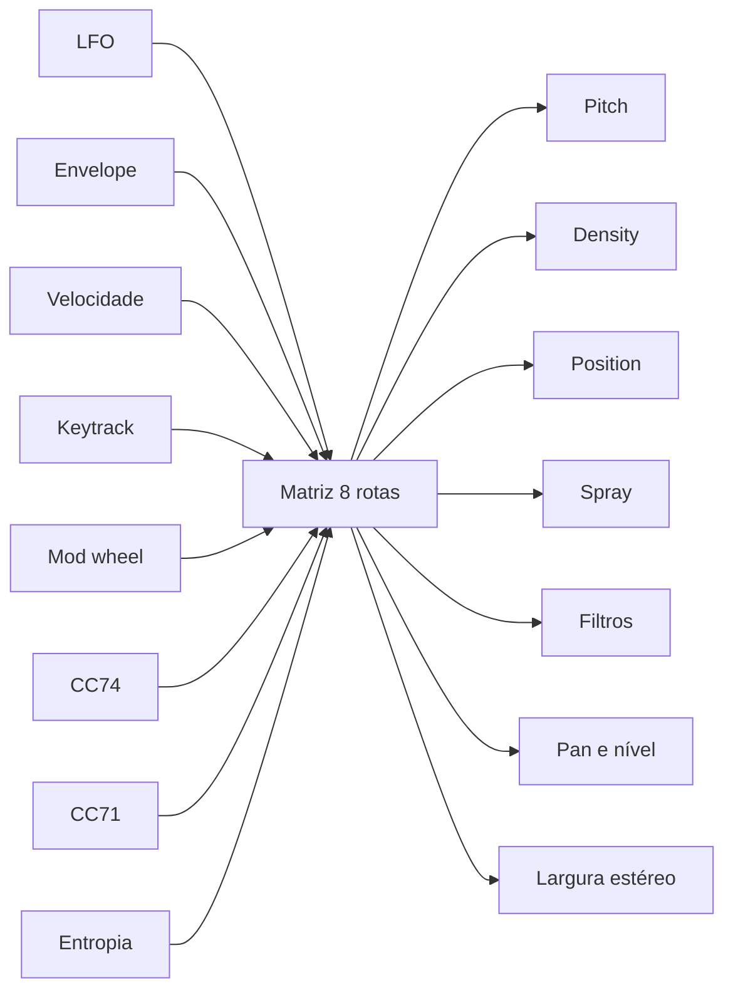

# Motor de som

## Fluxo de sinal


O parser lê o cabeçalho PE, valida cada seção e recorta os limites ao tamanho
real do arquivo. A conversão trata cada byte como amostra e normaliza o
resultado. O buffer fica em memória e alimenta as oito vozes do motor granular.

## Granulação

Cada grão nasce com quatro decisões tomadas no início:

1. Posição de leitura no buffer.
2. Passo de leitura, derivado de afinação, detune, spread e nota.
3. Duração, a partir de `SIZE` e do jitter.
4. Atraso, a partir de `CLOUD`.

O agendador dispara grãos na taxa de `DENSITY`. Uma voz livre recebe o grão. Se
as oito vozes estiverem ocupadas, o grão novo espera a próxima oportunidade. O
envelope do grão usa a janela escolhida em `WINDOW`.

A leitura avança em fração do buffer, não em amostras absolutas. O passo é
`semitons -> razão -> razão / comprimento da fonte`. Essa divisão impede que um
grão percorra o arquivo inteiro em poucas amostras. A razão fica limitada a
0,0625..16, o que cobre os ±48 semitons do `PITCH`.

**A posição é puxada para trás quando não há material à frente.** Um grão
precisa de `grainLength` amostras depois do ponto de partida; em `POSITION = 1,0`
ele lia o fim do buffer e morria na primeira amostra, e o instrumento emudecia
sem aviso. O início passa a ser `min(posição, 1 - min(grainLength * passo, 1))`,
já com o passo calculado. É o que impede o clique no canto direito do mapa de
entropia de calar o som.

**E o grão nunca ocupa mais de metade do material.** Numa região curta com pitch
alto, `grainLength * passo` passa de 1 e o tecto da posição cai para zero: todos
os grãos nasciam no início e o knob de posição e o spray ficavam mortos. Nesse
caso a janela é encurtada para `0,5 / passo` amostras (com o envelope reescalado,
para a forma fechar na mesma) e a posição volta a ter mapa. Um grão curto é som;
um grão impossível é silêncio.

## Spray

`SPRAY` sorteia um desvio uniforme para a posição de leitura de cada grão:

```
posição = clamp(POSITION + uniforme(-SPRAY, +SPRAY) + LFO, 0, 1)
```

O desvio é uma fração do material. `SPRAY = 0` mantém todos os grãos ancorados
na mesma posição. `SPRAY = 1` permite leitura em qualquer ponto do buffer.

O parâmetro não depende da entropia. A entropia só altera o spray quando o
usuário cria uma rota na matriz de modulação com fonte `Entropy` e destino
`Spray`. O Granulator II usa spray como dispersão da posição de leitura; o
Opcoda segue essa ideia, sem afirmar que a implementação seja idêntica.

## Entropia

O Opcoda mede entropia de Shannon por coluna de bytes. A unidade é bits por
byte, de 0 a 8. A curva tem no máximo 1024 pontos e alimenta a vista `ENT` e a
fonte `Entropy` da matriz.

Entropia mede incerteza da distribuição de bytes. Um bloco com um único valor
tem entropia 0; um bloco com os 256 valores igualmente distribuídos tem
entropia 8. A medida não é um gerador aleatório e não substitui o spray. O
spray sorteia posições; a entropia descreve o material.

O cálculo roda na thread de interface em `pe::reduceToColumns`. A thread de
áudio recebe a curva pronta.

## Largura estéreo

O material é mono — vem de bytes. O `STEREO` parte do mid/side e, acima de 1,
atrasa um canal para criar o spread que a fonte não tem:

```
abaixo de 1:  L = M + S·w,  R = M − S·w      (estreita até mono em 0)
acima de 1:   R = R(t − d),  d = 0 a 12 ms proporcional a w − 1
```

O atraso é uma linha de 12 ms com leitura interpolada, e a rampa do atraso é
por amostra, como a da largura: girar o knob não abre clique. Em 1,0 o atraso é
zero e as duas metades somam sem alteração. A matriz entra antes desta etapa,
portanto o destino `Stereo Width` também abre o Haas.

## Drive e clipping

O `DRIVE` do filtro 1 tem dois estágios. No grão, o ganho entra no `tanh`, que
satura e nunca passa de 1,0. No barramento, depois da soma e do gate, um clip
fecha o topo do curso: o teto é 1,0 até 6 dB e desce até 0,40 em 24 dB.

```
g = 10^(drive/20)
y = tanh(x·g)
depois da soma:  y = clamp(y, ±c),  c = 1,0 − 0,60·(drive − 6)/18
```

O teto é o que se ouve como clipping. Abaixo de 6 dB o clip não encosta e o
drive é ganho com saturação; a partir daí o pico deixa de depender do nível de
entrada, que é a diferença entre clip e volume. O limiter continua depois, como
rede.

## Modulação



A matriz soma as rotas por destino e limita o total a -1..+1. Cada destino usa
sua própria escala, por exemplo ±12 semitons em pitch e ±5 oitavas em corte. A
largura estéreo é multiplicativa: +1 oitava dobra o side, e o teto é o mesmo do
knob `STEREO`. As oito rotas são parâmetros automatizáveis e a vista MATRIX
(as teclas 1 a 4 do display) as edita.

## Tempo real

O callback de áudio não aloca, não bloqueia, não faz I/O e não lança exceções.
A interface envia material e parâmetros por átomos e uma fila SPSC. Um teste
substitui o `operator new` global e falha se o callback alocar.

## Limitações do motor

- Oito vozes de grão. O instrumento é mono com prioridade à última nota.
- Grãos de 1 a 100 ms.
- Filtros biquad de 12 ou 24 dB no primeiro estágio; o segundo estágio tem 12 dB.
- Sem FM, sem síntese espectral e sem reverb interno.
