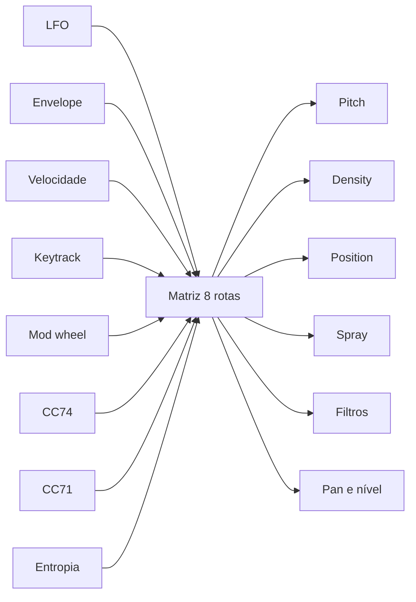

# Motor de som

## Fluxo de sinal


O parser lê o cabeçalho PE, valida cada seção e recorta os limites ao tamanho
real do arquivo. A conversão trata cada byte como amostra e normaliza o
resultado. O buffer fica em memória e alimenta as oito vozes do motor granular.

## Granulação

Cada grão nasce com quatro decisões tomadas no início:

1. Posição de leitura no buffer.
2. Passo de leitura, derivado de afinação, detune, spread e nota.
3. Duração, a partir de `SIZE` e do jitter.
4. Atraso, a partir de `CLOUD`.

O agendador dispara grãos na taxa de `DENSITY`. Uma voz livre recebe o grão. Se
as oito vozes estiverem ocupadas, o grão novo espera a próxima oportunidade. O
envelope do grão usa a janela escolhida em `WINDOW`.

A leitura avança em fração do buffer, não em amostras absolutas. O passo é
`semitons -> razão -> razão / comprimento da fonte`. Essa divisão impede que um
grão percorra o arquivo inteiro em poucas amostras.

## Spray

`SPRAY` sorteia um desvio uniforme para a posição de leitura de cada grão:

```
posição = clamp(POSITION + uniforme(-SPRAY, +SPRAY) + LFO, 0, 1)
```

O desvio é uma fração do material. `SPRAY = 0` mantém todos os grãos ancorados
na mesma posição. `SPRAY = 1` permite leitura em qualquer ponto do buffer.

O parâmetro não depende da entropia. A entropia só altera o spray quando o
usuário cria uma rota na matriz de modulação com fonte `Entropy` e destino
`Spray`. O Granulator II usa spray como dispersão da posição de leitura; o
Opcoda segue essa ideia, sem afirmar que a implementação seja idêntica.

## Entropia

O Opcoda mede entropia de Shannon por coluna de bytes. A unidade é bits por
byte, de 0 a 8. A curva tem no máximo 1024 pontos e alimenta a vista `ENT` e a
fonte `Entropy` da matriz.

Entropia mede incerteza da distribuição de bytes. Um bloco com um único valor
tem entropia 0; um bloco com os 256 valores igualmente distribuídos tem
entropia 8. A medida não é um gerador aleatório e não substitui o spray. O
spray sorteia posições; a entropia descreve o material.

O cálculo roda na thread de interface em `pe::reduceToColumns`. A thread de
áudio recebe a curva pronta.

## Modulação



A matriz soma as rotas por destino e limita o total a -1..+1. Cada destino usa
sua própria escala, por exemplo ±12 semitons em pitch e ±5 oitavas em corte.

## Tempo real

O callback de áudio não aloca, não bloqueia, não faz I/O e não lança exceções.
A interface envia material e parâmetros por átomos e uma fila SPSC. Um teste
substitui o `operator new` global e falha se o callback alocar.

## Limitações do motor

- Oito vozes de grão. O instrumento é mono com prioridade à última nota.
- Grãos de 1 a 100 ms.
- Filtros biquad de 12 ou 24 dB no primeiro estágio; o segundo estágio tem 12 dB.
- Sem FM, sem síntese espectral e sem reverb interno.
