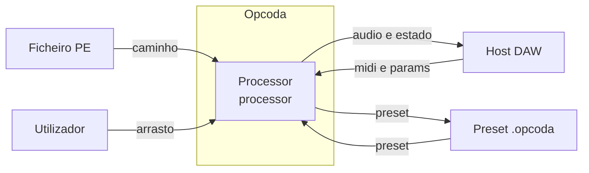

# Arquitetura

## Contexto

O Opcoda entra em cena por tres vias: o utilizador larga um executavel, o
host entrega MIDI e parametros, e o host entrega o estado de um projecto
guardado. Do outro lado, o plugin devolve audio, devolve estado e escreve
ficheiros de preset.



| fluxo | origem | destino | tipo |
| ---- | ------ | ------- | ---- |
| caminho | `src/opcoda_plugin/source/plugin_processor.cpp:145` | `src/opcoda_core/pe/pe_parser.cpp:65` | `std::vector<std::uint8_t>` |
| arrasto | `src/opcoda_plugin/source/plugin_editor.h:66` | `src/opcoda_plugin/source/plugin_processor.cpp:144` | `juce::String` |
| midi e params | `src/opcoda_plugin/source/plugin_processor.cpp:471` | `src/opcoda_core/rt/note_tracker.cpp:7` | `juce::MidiBuffer` e `float` |
| audio e estado | `src/opcoda_plugin/source/plugin_processor.cpp:499` | barramento de saida do host | `float`, dois canais |
| preset | `src/opcoda_plugin/source/plugin_processor.cpp:658` | ficheiro `.opcoda` | texto XML |

O ficheiro PE entra pela thread de interface e nunca pela thread de audio. A
leitura do disco acontece em `PluginProcessor::ingest`, que corre no editor.
O que viaja para o motor e' um ponteiro, e o que o motor devolve e' o
ponteiro antigo, para que a interface possa libertar a memoria quando quiser.

## Contentores

O repositorio tem duas camadas de codigo. `opcoda_core` e' C++20 puro e nao
inclui JUCE. `opcoda_plugin` e' a unica camada que depende do framework e da
thread de audio do host. A separacao nao e' estetica: e' o que permite ao
nucleo ser testado sem janela e sem host, e o que faz o guard de alocacao
poder vigiar a thread de audio.

```mermaid
%% Contentores: os modulos de dentro do repositorio e as fronteiras entre eles.
%% direction TB: o nucleo e' a base e o plugin esta por cima.
%% O nucleo e' C++20 puro e nao inclui JUCE. O plugin e' a unica camada que
%% depende do JUCE e da thread de audio do host.
classDiagram
  direction TB
  class opcoda_core:::abstract
  class opcoda_plugin:::abstract
  class pe:::concrete
  class entropy:::concrete
  class dsp:::concrete
  class rt:::concrete
  class view:::concrete
  class processor:::concrete
  class editor:::concrete
  opcoda_core <|-- pe
  opcoda_core <|-- entropy
  opcoda_core <|-- dsp
  opcoda_core <|-- rt
  opcoda_core <|-- view
  opcoda_plugin *-- opcoda_core
  opcoda_plugin <|-- processor
  opcoda_plugin <|-- editor
  processor -->|fila SPSC| dsp
  classDef abstract fill:#9AA0A6,stroke:#5F6368,color:#fff,fontStyle:italic
  classDef concrete fill:#ffffff,stroke:#8B1A1A,stroke-width:1px,color:#202124
```

| relacao | onde | o que significa |
| ------- | ---- | -------------- |
| `opcoda_core` para `pe` | `CMakeLists.txt:22` | leitura do PE, conversao de bytes, selecao de regiao |
| `opcoda_core` para `entropy` | `CMakeLists.txt:27` | entropia de Shannon por janela |
| `opcoda_core` para `dsp` | `CMakeLists.txt:33` | motor granular, janelas, filtros, limitador |
| `opcoda_core` para `rt` | `CMakeLists.txt:34` | fila sem trava, transporte, notas, guard de alocacao |
| `opcoda_core` para `view` | `src/opcoda_core/view/grain_trail.h:1` | rastro dos graos, sem JUCE |
| `opcoda_plugin` para `opcoda_core` | `src/opcoda_plugin/CMakeLists.txt:82` | o plugin liga o nucleo |
| `opcoda_plugin` para `processor` | `src/opcoda_plugin/CMakeLists.txt:61` | fronteira com o host |
| `opcoda_plugin` para `editor` | `src/opcoda_plugin/CMakeLists.txt:63` | interface |
| `processor` para `dsp` | `src/opcoda_plugin/source/plugin_processor.cpp:356` | fila SPSC, sem alocacao |

### O que cada modulo faz

`pe` le o formato. As quatro validacoes de `pe::parse` correm em ordem: `MZ`,
assinatura `PE`, numero de seccoes e limites da tabela. Qualquer uma delas
falha devolve um erro tipado, e nenhuma lanca excepcao. A conversao para
amostras e' aritmetica simples, `(byte - 127.5) / 127.5`, e a reducao a
colunas produz o minimo, o maximo, o RMS e a entropia de cada pedaco da
regiao.

`entropy` tem uma unica conta, `H = - soma de p(xi) log2 p(xi)`, e e'
calculada sobre histogramas de 256 caixas em pilha. Nao aloca.

`dsp` e' o motor. O agendador distribui graos ao longo do bloco, cada grao
nasce com posicao, ganho e pan, e a mistura passa por dois filtros biquad,
pelo gate ADSR e pelo limitador.

`rt` e' a camada de tempo real. A fila `SpscRing` e' a unica passagem de
dados entre threads, e o `Transport` mantem a posicao de leitura com
ordenacao acquire-release. O `NoteTracker` conta as notas sem saber nada
sobre JUCE. O `alloc_guard` substitui o `operator new` global e conta as
alocacoes que acontecem na thread de audio.

`view` guarda o rastro dos graos. Vive no nucleo porque e' aritmetica pura
sobre arrays fixos, e dentro de um componente JUCE nao ha como testar isso.

### Onde esta a fronteira de tempo real

`PluginProcessor::processBlock` e' o unico ponto onde a thread de audio
entra. A `PluginProcessor` tem duas filas: `incoming_` leva material novo
para o motor, `returned_` traz de volta o ponteiro que o motor ja nao usa.
As duas tem capacidade 4 e `SpscRing` exige tipo trivial, por isso o que
circula e' ponteiro cru e nao `shared_ptr`.

O buffer vive em `owned_`, que e' da thread de interface. A interface
liberta-o em `PluginEditor::refresh`, que corre a 60 Hz, e so depois de o
motor o ter devolvido. Sem esse acordo, um `delete` na thread de audio
seria um `free` a correr no meio do bloco.
