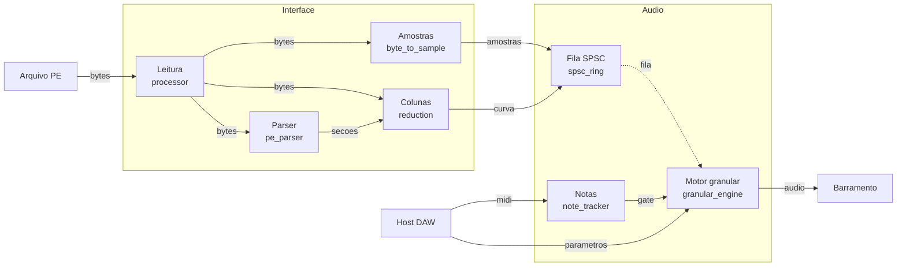
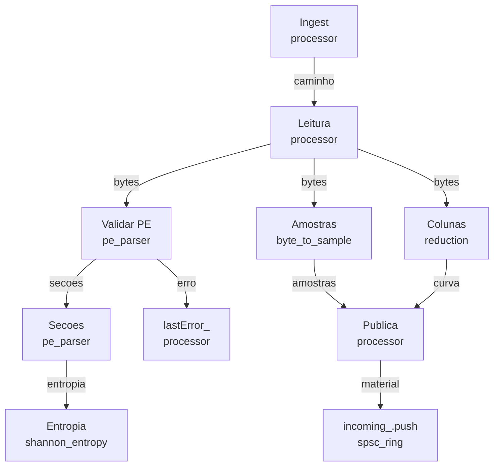
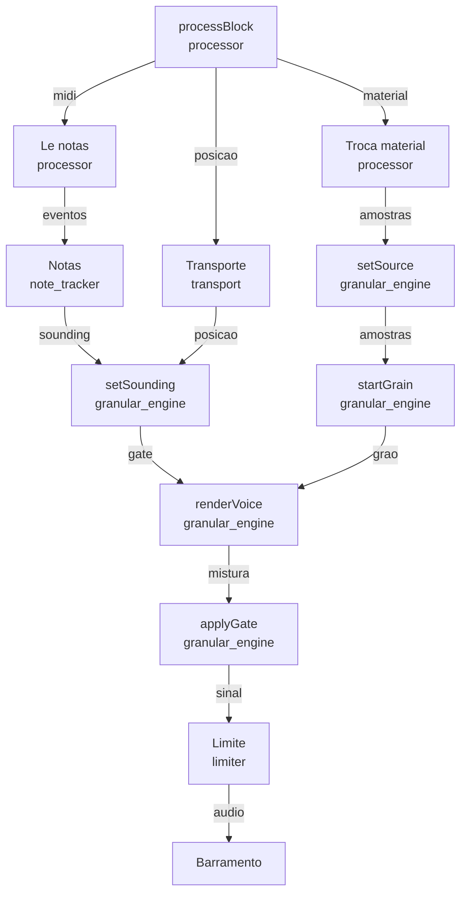

# Movimento de dados

## Nivel 0

Da esquerda para a direita: o ficheiro entra, o audio sai. As duas caixas
cinzentas sao as duas threads, e a fila SPSC e' a unica passagem entre elas.

| fluxo | tipo | origem | destino |
| ---- | ---- | ------ | ------- |
| bytes | `std::vector<std::uint8_t>` | `src/opcoda_plugin/source/plugin_processor.cpp:145` | `src/opcoda_core/pe/pe_parser.cpp:65` |
| bytes | `std::vector<std::uint8_t>` | `src/opcoda_plugin/source/plugin_processor.cpp:145` | `src/opcoda_core/pe/byte_to_sample.cpp:5` |
| bytes | `std::vector<std::uint8_t>` | `src/opcoda_plugin/source/plugin_processor.cpp:145` | `src/opcoda_core/pe/column_reduction.cpp:54` |
| secoes | `pe::Section` | `src/opcoda_core/pe/pe_parser.cpp:126` | `src/opcoda_core/pe/column_reduction.cpp:54` |
| amostras | `std::vector<float>` | `src/opcoda_core/pe/byte_to_sample.cpp:14` | `src/opcoda_plugin/source/plugin_processor.cpp:352` |
| curva | `std::vector<float>` | `src/opcoda_core/pe/column_reduction.cpp:163` | `src/opcoda_plugin/source/plugin_processor.cpp:353` |
| fila | `PublishedMaterial` | `src/opcoda_plugin/source/plugin_processor.cpp:356` | `src/opcoda_core/dsp/granular_engine.cpp:118` |
| midi | `juce::MidiBuffer` | `src/opcoda_plugin/source/plugin_processor.cpp:471` | `src/opcoda_core/rt/note_tracker.cpp:7` |
| gate | `bool` | `src/opcoda_core/rt/note_tracker.cpp:48` | `src/opcoda_core/dsp/granular_engine.cpp:65` |
| parametros | `dsp::GranularParams` | `src/opcoda_plugin/source/plugin_processor.cpp:484` | `src/opcoda_core/dsp/granular_engine.cpp:280` |
| audio | `float`, dois canais | `src/opcoda_core/dsp/granular_engine.cpp:478` | `src/opcoda_plugin/source/plugin_processor.cpp:499` |

A curva de entropia viaja com as amostras porque o motor nao a pode calcular.
Medir a entropia de toda a regiao dentro de `processBlock` seria trabalho de
tamanho da regiao dentro da thread de audio, e com o transporte a arrastar a
regiao isso acontecia a cada evento de rato. A medicao fica na thread de
interface, em `pe::reduceToColumns`, e o motor recebe a curva ja reduzida,
com no maximo 1024 pontos.

## Nivel 1: o ingest

Do ficheiro ate a fila. Tudo o que acontece aqui corre na thread de
interface, e por isso pode alocar.

| passo | codigo | o que move |
| ----- | ------ | ---------- |
| 1 | `src/opcoda_plugin/source/plugin_processor.cpp:144` | o caminho do ficheiro |
| 2 | `src/opcoda_plugin/source/plugin_processor.cpp:160` | os bytes crus |
| 3 | `src/opcoda_core/pe/pe_parser.cpp:65` | a estrutura do PE, ou um erro tipado |
| 4 | `src/opcoda_core/pe/pe_parser.cpp:126` | uma `Section` por seccao |
| 5 | `src/opcoda_core/entropy/shannon_entropy.cpp:21` | os bits por byte de cada seccao |
| 6 | `src/opcoda_core/pe/byte_to_sample.cpp:14` | as amostras em `[-1, 1]` |
| 7 | `src/opcoda_core/pe/column_reduction.cpp:163` | o minimo, o maximo, o RMS e a entropia de cada coluna |
| 8 | `src/opcoda_plugin/source/plugin_processor.cpp:317` | as amostras e a curva, em dois vectores |
| 9 | `src/opcoda_plugin/source/plugin_processor.cpp:356` | os dois ponteiros, para a fila |
| 10 | `src/opcoda_plugin/source/plugin_processor.cpp:167` | o erro, como `const char*` |

O erro tipado e' parte do fluxo e nao uma excepcao. `pe::toString` traduz
`PeError` para `E_BAD_MZ`, `E_BAD_PE`, `E_TRUNCATED`, `E_OOB`,
`E_TOO_MANY_SECTIONS` e companhia, e o processor guarda a cadeia em
`lastError_` para a interface mostrar.

Se a fila estiver cheia, `publishByteRange` recusa e devolve `E_BUSY`. Crescer
a fila seria alocar na thread de interface no meio de um arrasto, e o motor
ficaria com material antigo em vez de material novo.

## Nivel 1: o bloco de audio

Do host ate ao barramento. Nada disto aloca, nada disto bloqueia, e nada
disto le disco.

| passo | codigo | o que move |
| ----- | ------ | ---------- |
| 1 | `src/opcoda_plugin/source/plugin_processor.cpp:465` | o buffer e o MIDI do bloco |
| 2 | `src/opcoda_plugin/source/plugin_processor.cpp:373` | o `PublishedMaterial` que chegou |
| 3 | `src/opcoda_plugin/source/plugin_processor.cpp:387` | o ponteiro das amostras e o da curva |
| 4 | `src/opcoda_plugin/source/plugin_processor.cpp:414` | os eventos MIDI do bloco |
| 5 | `src/opcoda_core/rt/note_tracker.cpp:7` | as notas premidas e o pedal |
| 6 | `src/opcoda_core/rt/transport.cpp:122` | a fracao da regiao que o transporte leu |
| 7 | `src/opcoda_core/dsp/granular_engine.cpp:65` | o comando de abrir ou fechar o gate |
| 8 | `src/opcoda_core/dsp/granular_engine.cpp:178` | o grao: posicao, ganho, pan e janela |
| 9 | `src/opcoda_core/dsp/granular_engine.cpp:392` | a amostra interpolada, ja filtrada |
| 10 | `src/opcoda_core/dsp/granular_engine.cpp:495` | o nivel do envelope, aplicado a mistura |
| 11 | `src/opcoda_core/dsp/limiter.cpp:62` | o sinal saturado |
| 12 | `src/opcoda_plugin/source/plugin_processor.cpp:499` | os dois canais no barramento |

O gate vem antes do limitador de proposito. Fechar a rampa antes de saturar
mantem o tecto de saida independente de quantas notas estao a soar, que e'
a unica forma de o limite ser previsivel sob polifonia.

A ordem do bloco tambem e' fixa. `drainIncomingQueue` corre primeiro, para
que o material novo ja esteja no motor quando o bloco comeca. Depois vem o
MIDI, e so entao a posicao do transporte. `setSounding` recebe o OR entre as
notas e o transporte, e o motor so precisa de gate aberto para produzir.
