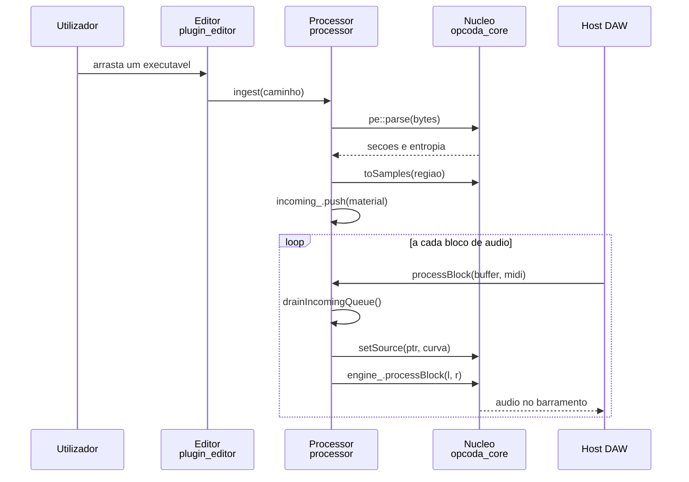

# Entradas e saidas

## Entradas

| entrada | sitio | dado |
| ------- | ----- | ---- |
| dialogo de ficheiro | `src/opcoda_plugin/source/plugin_editor.cpp:1430` | caminho, `juce::String` |
| arrasto de ficheiro | `src/opcoda_plugin/source/plugin_editor.h:66` | `juce::StringArray` |
| estado do host | `src/opcoda_plugin/source/plugin_processor.cpp:637` | bloco XML |
| MIDI do host | `src/opcoda_plugin/source/plugin_processor.cpp:471` | `juce::MidiBuffer` |
| parametros do host | `src/opcoda_plugin/source/plugin_processor.cpp:83` | `float`, 28 parametros |
| taxa de amostragem | `src/opcoda_plugin/source/plugin_processor.cpp:120` | `double` |
| fila de entrada | `src/opcoda_plugin/source/plugin_processor.cpp:356` | `PublishedMaterial` |
| fila de devolucao | `src/opcoda_plugin/source/plugin_processor.cpp:380` | `PublishedMaterial` |
| preset do disco | `src/opcoda_plugin/source/plugin_processor.cpp:601` | `juce::XmlElement` |
| ficheiro PE pelo nucleo | `src/opcoda_core/pe/pe_parser.cpp:166` | `std::vector<std::uint8_t>` |

O ficheiro PE tem duas portas de entrada. O plugin le o ficheiro ele proprio
e chama `pe::parse` com o vector ja em memoria, e `pe::parseFile` le e
chama `pe::parse` numa so chamada, para quem usar o nucleo sem JUCE.

Os 29 parametros sao lidos uma vez por bloco, em `currentParams`, e copiados
para `dsp::GranularParams`. O motor nunca guarda referencia para o estado do
host. O valor lido e' o valor cru, e nao o normalizado, porque o que o
utilizador ve e' o que o motor tem de receber.

## Saidas

| saida | sitio | dado |
| ----- | ----- | ---- |
| audio para o host | `src/opcoda_plugin/source/plugin_processor.cpp:499` | `float`, dois canais |
| estado para o host | `src/opcoda_plugin/source/plugin_processor.cpp:595` | bloco XML |
| parametro para o host | `src/opcoda_plugin/source/plugin_processor.cpp:457` | `float` normalizado |
| preset para o disco | `src/opcoda_plugin/source/plugin_processor.cpp:658` | texto XML |
| telemetria para a interface | `src/opcoda_plugin/source/plugin_processor.cpp:522` | `std::atomic<float>` e `std::atomic<int>` |
| graos para a interface | `src/opcoda_core/dsp/granular_engine.cpp:492` | `dsp::GrainTelemetry` |
| erro de parser | `src/opcoda_plugin/source/plugin_processor.cpp:167` | `const char*` |
| erro de abertura | `src/opcoda_plugin/source/plugin_processor.cpp:147` | `const char*` |
| erro de fila cheia | `src/opcoda_plugin/source/plugin_processor.cpp:359` | `const char*` |
| erro de fonte em falta | `src/opcoda_plugin/source/plugin_processor.cpp:632` | `const char*` |

A telemetria e' lida de lado, com atomicos soltos em vez de uma struct
protegida por lock. Nao ha fotografia consistente entre os campos, e para
uma leitura de pico e contagem de vozes isso nao interessa. O que interessa
e' que o custo seja zero para a thread de audio, e um `CriticalSection` por
bloco seria o oposto do que este projecto persegue.

O parametro que sai para o host e' o unico caminho de volta de um CC. Os
controladores sao aplicados na thread de interface, em
`applyPendingControllerChanges`, e nao durante o `processBlock`. Escrever no
parametro directamente da thread de audio notificaria os listeners, e um
deles e' o `SliderParameterAttachment` da interface.

## Erros

Os erros do Opcoda sao codigos de texto, nao excepcoes. `pe::toString`
traduz o enumerado `PeError` para uma cadeia estavel, e a interface mostra a
cadeia tal e qual.

| codigo | quando |
| ------ | ------ |
| `E_OPEN` | o ficheiro nao abre |
| `E_EMPTY` | o ficheiro esta vazio |
| `E_TRUNCATED` | a leitura devolveu menos bytes do que o tamanho declarado |
| `E_BAD_MZ` | a assinatura `MZ` nao esta no inicio |
| `E_BAD_E_LFANEW` | o offset do cabecalho PE esta fora do ficheiro |
| `E_BAD_PE` | a assinatura `PE` nao esta no sitio |
| `E_BAD_OPTIONAL_HEADER` | o cabecalho opcional e' curto demais |
| `E_TOO_MANY_SECTIONS` | o numero de seccoes e' zero ou passa de 96 |
| `E_BAD_SECTION_TABLE` | a tabela de seccoes nao cabe no ficheiro |
| `E_OOB` | uma seccao declara mais bytes do que o ficheiro tem |
| `E_BUSY` | a fila de entrada esta cheia |
| `E_SOURCE_MISSING` | o projecto aponta para um ficheiro que ja nao esta la |

Nenhuma excepcao atravessa a fronteira do plugin. O `operator new` global
substituido pelo guard de alocacao lanca `std::bad_alloc` quando a memoria
falha, e isso acontece antes de qualquer fronteira de ABI.

## Caminho quente

O caminho que se percorre quando se larga um ficheiro e se quer saber onde
falhou.

O arrasto e' tratado em `PluginEditor::filesDropped`, que chama
`ingestFirst`. O dialogo de ficheiro faz o mesmo por `chooseFile`. Os dois
caminhos acabam no mesmo `PluginProcessor::ingest`, e nao ha caminho
paralelo: o ingest e' unico e tem ensaio.

Dentro do ingest, a ordem das validacoes do PE e' a do codigo, e cada falha
devolve logo. `E_BAD_MZ` sai em `pe_parser.cpp:76`, `E_BAD_PE` em
`pe_parser.cpp:89`, e o resto segue a mesma ordem. O `SizeOfRawData` que o
cabecalho declara nao e' de fiar: e' recortado ao que existe no ficheiro, e
um valor declarado maior do que o disponivel devolve `E_OOB` em
`pe_parser.cpp:142`.

A troca de material acontece no inicio do bloco, em `drainIncomingQueue`.
O motor recebe o ponteiro novo em `setSource` e o ponteiro antigo volta
pela fila de devolucao. A interface liberta-o no `refresh` seguinte, a 60 Hz.

A telemetria e' publicada no fim de cada bloco, em `telemetry_.publish`, e o
editor le-a no seu temporizador, sem nunca pedir ao motor que processe um
bloco so para saber o que aconteceu.
